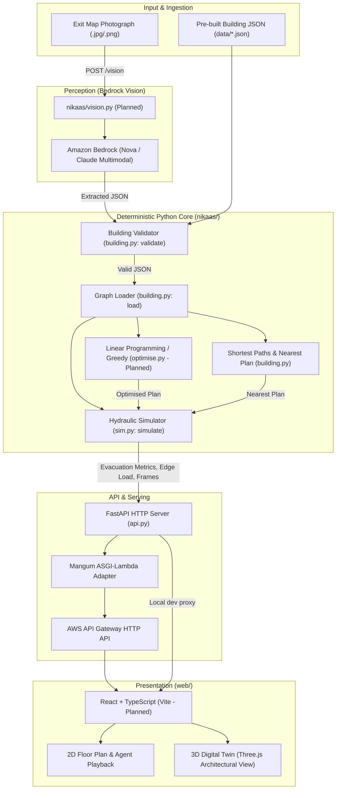

# NIKAAS — System Architecture & Component Interaction

## 1. System Overview

NIKAAS is designed as a hybrid edge/cloud digital twin for emergency building evacuation.
It bridges visual floor-plan comprehension (via AI) with deterministic physical simulation (via SFPE egress hydraulics) and mathematical optimization (via linear programming).



---

## 2. Current Architecture (As Implemented Today)

At present, only the core deterministic backend engine and its local FastAPI service exist:

1. **Topology Model (`nikaas/building.py`):**
   - In-memory node-edge graph representation (`Building`, `Edge`).
   - Bidirectional adjacency mapping `b.adj[node] -> [(neighbor, Edge)]`.
   - Node coordinate system in metres (`x`, `z`), accommodating room bounding boxes (`w`, `d`).
   - Dijkstra shortest path solver with strict node-level exclusion for `blocked` destinations/stairs.
   - Comprehensive rule-based validator `validate(dict)` producing human-readable diagnostics.

2. **Hydraulic Simulation Engine (`nikaas/sim.py`):**
   - Discrete-time simulation operating at `DT = 0.25 s`.
   - Implementation of the **SFPE Handbook of Fire Protection Engineering** hydraulic movement model:
     - Clear walking speed: $1.19\text{ m/s}$.
     - Stair traversal speed: $0.85\text{ m/s}$.
     - Specific flow capacity ($F_s$): Corridor $= 1.3\text{ p/s/m}$, Door $= 1.3\text{ p/s/m}$, Stair $= 1.1\text{ p/s/m}$.
   - Edge capacity credit accumulator: capacity is carried over between timesteps; idle edges are clamped to a max burst of $1.0$ person credit.
   - Per-edge FIFO queuing: people queue at entrance to each bottleneck segment.
   - Output includes evacuation duration (`total_time_s`), exit breakdown (`per_exit`), worst bottleneck (`bottleneck`), edge congestion ranking (`edge_load`), complete per-room node routes (`routes`), and 1-second sampled animation frames (`frames`).

3. **HTTP API (`nikaas/api.py`):**
   - FastAPI application with broad CORS enabled.
   - Endpoints:
     - `GET /health` — Service alive probe.
     - `POST /validate` — Validates arbitrary building JSON payloads against contract constraints.
     - `POST /simulate` — Runs simulation on provided building graph, plan (or default nearest), and blocked list.
   - ASGI Lambda handler exposed via `Mangum(app)`.

4. **Data & Artifacts:**
   - Topology files: `data/sample_floor.json` (300 occupants) and `data/lab_block.json` (528 occupants).
   - Upstream additions: `data/iit_kgp_museum.json` (507 occupants, real museum floor plan).
   - Pre-computed frame recordings: `data/frames_*.json`.
   - Experimental benchmark log: `runs/results.csv`.

---

## 3. Target Architecture (For Hackathon Finale)

To fulfill the complete hackathon promise and rubric requirements, the architecture must expand to incorporate:

```mermaid
sequenceDiagram
    autonumber
    actor User as User / Judge
    participant Web as Web App (web/)
    participant API as FastAPI / API GW (api.py)
    participant Vision as Bedrock Vision (vision.py)
    participant Opt as Optimiser (optimise.py)
    participant Sim as Simulator (sim.py)

    Note over User,Web: Scenario 1: Map Digitisation
    User->>Web: Uploads exit map photograph
    Web->>API: POST /vision (multipart image)
    API->>Vision: Call Bedrock Converse API with prompt
    Vision-->>API: Extracted graph JSON
    API->>API: validate(extracted_json)
    API-->>Web: Return validated building JSON (or warnings)
    Web->>User: Display editable graph editor overlay

    Note over User,Web: Scenario 2: Baseline Simulation
    User->>Web: Clicks "Simulate Evacuation"
    Web->>API: POST /simulate (building, plan=null)
    API->>Sim: Run nearest-exit simulation
    Sim-->>API: Result {total_time_s, bottleneck, frames, routes}
    API-->>Web: JSON response
    Web->>User: Playback 2D/3D evac animation, show time & bottleneck

    Note over User,Web: Scenario 3: Nikaas Optimisation
    User->>Web: Clicks "Optimise Exit Allocation"
    Web->>API: POST /optimise (building)
    API->>Opt: Solve LP lower bound & greedy room-to-exit reassignment
    Opt->>Sim: Verify candidate plans
    Opt-->>API: Result {plan, total_time_s, lower_bound_s}
    API-->>Web: Return optimised plan & comparative savings
    Web->>User: Display side-by-side comparison ("Wow number")

    Note over User,Web: Scenario 4: Dynamic Re-routing (Tap-to-Block)
    User->>Web: Taps Stair A to block it
    Web->>API: POST /simulate (building, blocked=["A"])
    API->>Sim: Re-route all rooms avoiding Stair A
    Sim-->>API: Result with new evac time and new bottleneck
    Web->>User: Animate flame/hazard at Stair A, re-render paths
```

---

## 4. Component Interfaces & Data Contracts

### 4.1 Internal Python Interfaces

| Caller | Callee | Function / Signature | Return Value |
|---|---|---|---|
| `api.py` / `test_*.py` | `building.py` | `validate(d: dict) -> list[str]` | List of error strings (empty if valid) |
| `api.py` / `sim.py` | `building.py` | `load(src: dict | str | Path) -> Building` | `Building` dataclass instance |
| `sim.py` | `building.py` | `shortest_path(b, src, dst, blocked=()) -> (float, list[str])` | `(distance_metres, [node_ids])` |
| `api.py` / `sim.py` | `building.py` | `nearest_plan(b, blocked=()) -> dict[str, str]` | `{room_id: exit_id}` mapping |
| `api.py` / `optimise.py` | `sim.py` | `simulate(b, plan, blocked=(), seed=7, ...) -> dict` | Full simulation result dictionary |
| `api.py` (Planned) | `optimise.py` | `optimise(b, blocked=()) -> dict` | `{"plan": dict, "total_time_s": float, "lower_bound_s": float}` |
| `api.py` (Planned) | `vision.py` | `extract_graph_from_image(image_bytes: bytes) -> dict` | Raw building dictionary matching contract |

### 4.2 External API Contracts

- **`GET /health`**
  - Response: `{"ok": true}`
- **`POST /validate`**
  - Request: `{"building": { "nodes": [...], "edges": [...] }}`
  - Response: `{"ok": bool, "problems": string[]}`
- **`POST /simulate`**
  - Request: `{"building": {...}, "plan": {room: exit} | null, "blocked": string[]}`
  - Response:
    ```json
    {
      "total_time_s": 119.0,
      "completed": true,
      "people": 300,
      "per_exit": { "A": 174, "B": 126 },
      "bottleneck": "c_w-A",
      "peak_queue": 92,
      "edge_load": { "c_w-A": 92, "c_e-B": 64, "...": 0 },
      "routes": { "lab1": ["lab1", "c_l1", "c_w", "A"], "...": [...] },
      "plan": { "lab1": "A", "...": "..." },
      "frames": [
        { "t": 0.25, "people": [[-15.0, -7.0, "queuing"], "..."] },
        { "t": 1.0, "people": [[-15.0, -6.8, "walking"], "..."] }
      ]
    }
    ```
- **`POST /optimise` (Target Contract in `docs/CONTRACT.md`)**
  - Request: `{"building": {...}, "plan": null, "blocked": string[]}`
  - Response: `{"plan": {room: exit}, "total_time_s": float, "lower_bound_s": float}`

---

## 5. Architectural Boundaries & Isolation Strategy

1. **Deterministic Core Isolation:**
   - The simulator and optimiser have zero dependencies on web frameworks or AWS SDKs.
   - All random generation in the simulator (`start` delays, initial room offsets) is tied to an explicit `seed=7`. Same input always yields identical floating-point output down to the millisecond.
2. **Offline / Demo Resilience (`?demo=1` mode):**
   - If the AWS Lambda deployment is delayed or Wi-Fi drops at the venue, the frontend can run fully offline in browser by replaying pre-compiled frame files (`data/frames_*.json`).
   - If Bedrock vision is unavailable or misinterprets an image, the system falls back seamlessly to the pre-digitised canonical graphs (`data/lab_block.json` / `data/iit_kgp_museum.json`).
