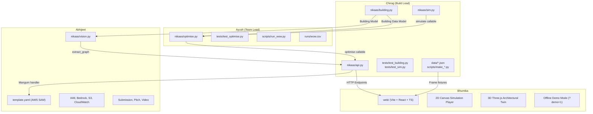

# NIKAAS — Team Integration Map & Responsibility Matrix

## 1. Team Responsibilities & Ownership Matrix

NIKAAS is built by a 4-person team under strict hackathon time constraints. Work is divided by clean file boundaries specified in `docs/TASKS.md` and `docs/tasks/*.md`.

---

## 2. Per-Member Ownership & Deliverable Tracker

### Chirag R H — Build Lead, Simulator & Core API
- **Primary Files Owned:**
  - `nikaas/building.py` (Graph loading, Dijkstra, validator)
  - `nikaas/sim.py` (Hydraulic simulation engine)
  - `nikaas/api.py` (FastAPI app, `/health`, `/validate`, `/simulate`, Lambda handler)
  - `tests/test_building.py`, `tests/test_sim.py`
  - `data/*.json` (Graph definitions)
  - `scripts/make_lab_block.py`, `scripts/run_nearest.py`
- **Upcoming Deliverables:**
  - Wire `/optimise` endpoint into `nikaas/api.py` once Ayush delivers `optimise()`.
  - Wire `/vision` endpoint into `nikaas/api.py` once Abhijeet delivers `extract_graph()`.
  - Review all PRs and ensure strict contract compliance.

### Ayush V U — Team Lead, Optimiser, Lower Bound & "Wow Number"
- **Primary Files Owned:**
  - `nikaas/optimise.py` (Greedy exit reallocation + SciPy LP lower bound)
  - `tests/test_optimise.py` (Optimization unit tests)
  - `scripts/run_wow.py` (Benchmark comparing Nearest vs Optimised vs Blocked)
  - `runs/wow.csv` (Verifiable benchmark metrics)
- **Upcoming Deliverables:**
  - **Greedy heuristic (by 14:00):** Iteratively reassign rooms from the bottleneck exit to alternative reachable exits until evacuation time cannot be reduced further.
  - **LP Lower Bound (by 17:00):** Time-expanded network flow formulation using `scipy.optimize.linprog(method='highs')`.
  - **"Beat Nikaas" score:** Function allowing judges to submit custom room-to-exit plans and comparing against the algorithmic optimum.

### Bhumika G — Web Application, 2D Player & 3D Twin
- **Primary Directory Owned:**
  - `web/` (Scaffolded using Vite, React, TypeScript; zero external heavy UI kits)
- **Upcoming Deliverables:**
  - **2D Top-Down Player (by 15:30):** Renders rooms, corridors, stairs, and animated occupants from `frames` array; color-codes by state (`walking`=orange, `queuing`=red, `stairs`=blue, `out`=hidden).
  - **Live Backend Integration (by 19:00):** Connects to `POST /simulate` and `POST /optimise`.
  - **Tap-to-Block Feature:** User clicks any exit/stair $\to$ re-runs simulation with that node in `blocked` $\to$ re-animates flow and shows new bottleneck.
  - **3D Architectural Twin (Phase 2, after 19:00):** Three.js perspective view following `docs/VISUAL_STYLE.md` (matte white walls, glowing green route ribbons, heat rings at blocked stairs).
  - **Demo Fallback (`?demo=1`):** Client-side replay of `data/frames_*.json` without requiring live backend.

### Abhijeet — AWS Cloud, Bedrock Vision, Infrastructure & Submission
- **Primary Files Owned:**
  - `template.yaml` (AWS SAM infrastructure-as-code)
  - `nikaas/vision.py` (Amazon Bedrock Converse API with image multimodal prompt)
  - Pitch presentation, demo video recording, Unstop submission form
- **Upcoming Deliverables:**
  - **AWS Setup (Immediate priority):** Configure AWS credentials and Bedrock model access (Amazon Nova / Anthropic Claude).
  - **SAM Deployment (by 15:30):** Deploy API Gateway HTTP API pointing to `nikaas.api.handler` via Lambda Python 3.11 + S3 static website hosting.
  - **Photo-to-Graph Extraction (by 19:00):** Bedrock prompt that ingests emergency exit map photos and produces JSON complying with `docs/CONTRACT.md`.

---

## 3. Shared Integration Points & Protocols

| Shared Interface / Boundary | Consumer | Provider | Protocol / Agreement |
|---|---|---|---|
| `docs/CONTRACT.md` | All team members | Chirag (Build Lead) | **FROZEN.** No changes permitted without consensus and build lead approval. |
| `POST /simulate` | `web/` (Bhumika) | `nikaas/api.py` (Chirag) | Input: `{building, plan, blocked}`. Output: `{total_time_s, completed, bottleneck, edge_load, routes, frames}`. |
| `POST /optimise` | `web/` (Bhumika) | `nikaas/optimise.py` (Ayush) via `api.py` (Chirag) | Input: `{building, blocked}`. Output: `{plan, total_time_s, lower_bound_s}`. |
| `POST /vision` | `web/` (Bhumika) | `nikaas/vision.py` (Abhijeet) via `api.py` (Chirag) | Input: Multipart image upload. Output: `{building: {...}}` validated via `building.validate()`. |
| Lambda Handler | AWS SAM (Abhijeet) | `nikaas/api.py` (Chirag) | Exposed as `nikaas.api.handler` via Mangum adapter. |
| Pre-computed Frames | `web/` (Bhumika) | `data/frames_*.json` (Chirag) | Standalone fixtures for frontend prototyping before live API is up. |

---

## 4. Team Operational Rules (From `docs/TASKS.md`)

1. **Mandatory Hourly Commit Checkpoints:**
   Small, atomic commits with informative messages. Always run `git pull --rebase` before `git push`.
2. **"Notes from Chirag" Communication Channel:**
   Each member's task file under `docs/tasks/<name>.md` concludes with a chronological "Notes from Chirag" section. Members must read this section immediately after every `git pull`.
3. **No Fabricated Measurements:**
   Every number shown in pitch decks, READMEs, or frontend comparison panels must originate from a script that writes to `runs/` (e.g., `runs/results.csv`, `runs/wow.csv`).
4. **Strict Isolation from Concept Video Mockups:**
   All code must be authored fresh inside the repository. Do not copy concept demo files (e.g. `video/scenes3d.html`).
5. **30-Minute Fallback Trigger:**
   If any member is blocked for more than 30 minutes, they must immediately escalate to Chirag and transition to their designated fallback path.
