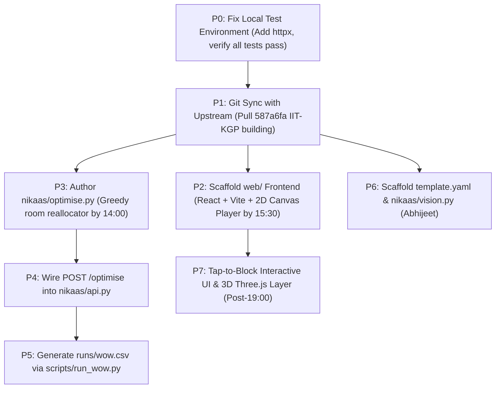

# NIKAAS — Technical Risks, Bugs & Strategic Recommendations

## 1. Discovered Bugs & Operational Blockers

### Bug 1: Missing `httpx` Dependency Breaks API Acceptance Tests
- **Symptom:** Running `pytest tests/` triggers:
  `RuntimeError: The starlette.testclient module requires the httpx2 package to be installed. You can install this with: $ pip install httpx2`
  This causes `test_sim.py::test_api_returns_edge_load_and_lambda_handler_exists` to fail, and completely prevents `test_building.py` from even collecting due to top-level `from fastapi.testclient import TestClient`.
- **Root Cause:** `fastapi`'s `TestClient` delegates to Starlette's `TestClient`, which requires `httpx`. `requirements.txt` lists `fastapi`, `uvicorn`, `pydantic`, `pytest`, `mangum`, but omits `httpx`.
- **Immediate Recommendation:** Add `httpx` to `requirements.txt` and install into `.venv`:
  `pip install httpx`

### Bug 2: Frame 0 Timestamp & State Discrepancy
- **Symptom:** The first recorded frame is at `t = 0.25 s`, not `0.00 s`. The interval between frame 0 and frame 1 is $0.75\text{ s}$, whereas all subsequent frames are spaced at $1.00\text{ s}$. Additionally, occupants with default `start = 0.0` immediately transition to `"queuing"`, meaning state `"inside"` is never present in any recorded frame.
- **Root Cause:** In `nikaas/sim.py`, `t` starts at `0.0`, is incremented to `0.25` on the first iteration, and `t >= next_frame` ($0.25 \ge 0.0$) triggers frame capture after the queue update.
- **Immediate Recommendation:** For visualization consistency, record an initial frame at $t = 0.0$ before the time-stepping loop begins, or ensure the frontend handles the initial $0.25\text{ s}$ frame smoothly.

### Bug 3: Bidirectional Queue Coupling on Edge Key
- **Symptom:** `Edge.key` is formatted as `f"{self.a}-{self.b}"`. In `sim.py`, both `(a, b)` and `(b, a)` are mapped to the same `Edge` instance and share `queues[e.key]`.
- **Risk:** If a floor plan contains rooms whose routes traverse a corridor segment in opposing directions, opposing occupants enter the same single-lane FIFO queue rather than passing each other.
- **Assessment for Hackathon:** For tree-structured egress toward peripheral staircases, flow is 99% unidirectional toward exits. It does not cause a crash, but should be documented as a known simulation constraint.

---

## 2. Infrastructure & Tooling Risks

| Risk Area | Severity | Impact | Mitigation Strategy |
|---|---|---|---|
| **AWS CLI / SAM Not Installed** | **HIGH** | Local development machine cannot package or deploy SAM template directly. | 1. Abhijeet can handle cloud deploys from his laptop if configured.<br/>2. Alternatively, install AWS CLI and SAM on this machine.<br/>3. Keep local FastAPI as primary fallback for live judging. |
| **Bedrock Vision Extraction Failure** | **HIGH** | Photos of physical exit maps often have glare, irregular fonts, non-standard symbols, or non-orthogonal lines, leading to malformed graph JSON. | 1. Always route vision output through `validate()`.<br/>2. If `validate()` fails, return human-readable problems.<br/>3. Fallback: Pre-digitised canonical maps (`lab_block.json`, `iit_kgp_museum.json`) ensure zero demo disruption. |
| **SciPy LP Solver Complexity** | **MEDIUM** | Implementing a full time-expanded dynamic network flow LP under hackathon pressure may exceed time budget or encounter numerical instability. | 1. Prioritize Ayush's **greedy optimization heuristic** first by 14:00.<br/>2. Compute analytical lower bound: $\max\left(\frac{\sum \text{people}}{\sum \text{exit flow}}, \min(\text{walk times})\right)$.<br/>3. Add HiGHS LP only if time permits before 17:00. |
| **Three.js Performance & Timeline** | **MEDIUM** | Rendering 500+ animated 3D human silhouettes with smooth frame interpolation can consume excessive developer hours and GPU resources. | 1. Ensure the **2D Canvas player** is 100% complete and polished by 15:30 as the baseline.<br/>2. Build 3D as an enhancement layer after 19:00.<br/>3. Use instanced meshes (`InstancedMesh`) in Three.js if 3D is pursued. |
| **Wi-Fi / Network Outage during Judging** | **HIGH** | Cloud API or Bedrock endpoints become unreachable during live stage presentation. | 1. Frontend must support `?demo=1` mode to play pre-baked frames without network calls.<br/>2. Run FastAPI locally on the demo laptop (`uvicorn nikaas.api:app --port 8000`). |

---

## 3. Git Synchronization & Branch Strategy

### Current Status
- Local branch: `main` at `f206a10`.
- Remote `origin`: `AyushVUpadhye/Nikaas` at `2a82545` (local is **ahead by 2 commits**).
- Remote `upstream`: `thegoodengineers/Nikaas` at `587a6fa` (local is **behind by 1 commit**).

### Recommended Git Action Plan
1. Do not overwrite or rebase destructively.
2. In subsequent engineering sessions, cleanly merge or rebase onto `upstream/main`:
   ```bash
   git pull --rebase upstream main
   ```
   This will cleanly pull commit `587a6fa` (Chirag's real IIT Kharagpur museum floor plan panel, overlay map, and credit test) on top of local work.
3. Push the synchronized `main` branch to fork `origin`:
   ```bash
   git push origin main
   ```

---

## 4. Prioritized Engineering Recommendations for the Remaining Hackathon



### Milestone Milestones
- **By 14:00:** Greedy optimiser working on `lab_block.json` and `iit_kgp_museum.json`, showing measurable improvement over nearest exit.
- **By 15:30 (Checkpoint 1):** Working 2D player in `web/` rendering rooms, corridor paths, and animated agent dots with speed controls.
- **By 17:00:** Analytical / LP lower bound completed; `scripts/run_wow.py` populating `runs/wow.csv`.
- **By 19:00 (Checkpoint 2):** Live API wired to frontend; tap-to-block interactive re-routing live; Bedrock vision prototype.
- **By 23:00 (Checkpoint 3):** SAM deployment live on AWS; S3 hosting frontend; fallback `?demo=1` confirmed working offline.
- **By 07:30:** Code freeze; video recorded; pitch deck finalized.
