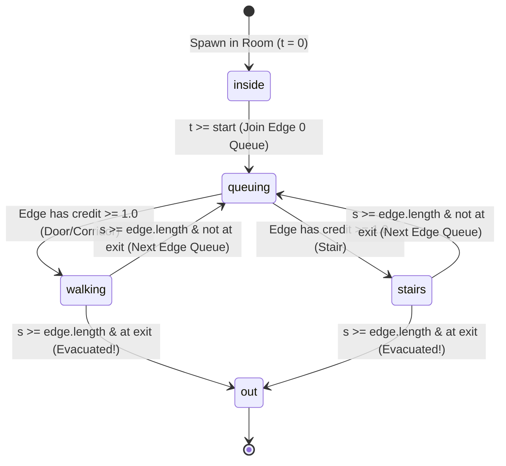

# NIKAAS — Evacuation Simulator Deep Dive

## 1. Theoretical Foundation: The SFPE Hydraulic Movement Model

NIKAAS' simulation engine (`nikaas/sim.py`) implements the macroscopic hydraulic egress model formulated in the **SFPE Handbook of Fire Protection Engineering** (5th edition, Chapter *"Emergency Movement"*, Gwynne & Rosenbaum).

The fundamental principle treats crowd evacuation analogously to fluid flow through piped networks:
1. People move at free velocity until local density or physical constraints create a restriction.
2. Every portal, corridor segment, or staircase possesses a maximum throughput proportional to its clear width $W$ and specific flow capacity $F_s$:
   $$Q = W \times F_s$$
   where $Q$ is in persons per second ($p/s$), $W$ is clear effective width in metres, and $F_s$ is specific flow in persons per second per metre of width ($p/s/m$).
3. When arrival flow exceeds capacity ($Q_{\text{in}} > Q_{\text{out}}$), people cannot compress infinitely; instead, a waiting queue forms at the edge boundary.

### Engineering Parameters in Nikaas
- **Horizontal Walking Speed ($v_{\text{walk}}$):** $1.19\text{ m/s}$ ($4.28\text{ km/h}$), standard SFPE unimpeded horizontal speed across level surfaces.
- **Stairway Travel Speed ($v_{\text{stair}}$):** $0.85\text{ m/s}$, measured along the stair slope for standard riser/tread geometry.
- **Specific Flow Constants ($F_s$):**
  - Corridors: $1.3\text{ persons / s / m}$
  - Doors: $1.3\text{ persons / s / m}$
  - Stairs: $1.1\text{ persons / s / m}$ (reduced due to vertical step negotiation)
- **Simulation Time Step ($\Delta t$):** $0.25\text{ s}$ ($4\text{ ticks per second}$).

---

## 2. Mathematical Mechanics: The Credit Accumulator & Queue Dynamics

A naive time-stepped simulation can suffer from significant quantization error when dealing with fractional flow.
For example, for a $1.0\text{ m}$ door with capacity $Q = 1.3\text{ p/s}$, in a timestep $\Delta t = 0.25\text{ s}$, exactly $0.325$ persons should pass through. Since individuals are discrete, naive integer rounding causes massive discrepancies.

### The Fractional Credit Mechanism
NIKAAS solves this via an edge credit accumulator (`credit[k]`):

```python
cap[k] = e.width * SPECIFIC_FLOW[e.kind]       # persons per second
credit[k] += cap[k] * DT                       # credit gained per tick

while q and credit[k] >= 1.0:
    credit[k] -= 1.0
    p = people[q.pop(0)]                       # admit person into edge
    p.state = "stairs" if e.kind == "stair" else "walking"
    p.s = 0.0

if not q:
    credit[k] = min(credit[k], 1.0)            # clamp idle credit
```

### Analytical Hand Calculation Check (`test_single_door_matches_hand_calculation`)
For $n = 120$ people exiting a room via a door of width $w = 1.0\text{ m}$ followed by a corridor of length $L = 10.0\text{ m}$:
- Door flow rate: $Q = 1.0 \times 1.3 = 1.3\text{ p/s}$.
- Time for all $120$ people to enter the door: $T_{\text{queue}} = \frac{n}{Q} = \frac{120}{1.3} \approx 92.31\text{ s}$.
- Time for the final person to walk length $L$: $T_{\text{walk}} = \frac{L}{v} = \frac{10.0}{1.19} \approx 8.40\text{ s}$.
- Expected total evacuation time:
  $$T_{\text{total}} = T_{\text{queue}} + T_{\text{walk}} \approx 92.31 + 8.40 = 100.71\text{ s}$$
- In `nikaas/sim.py`, this test completes in exactly $\approx 100.75\text{ s}$, matching within $< 0.1\%$ of the analytical prediction.

### Idle Clamping Protection
If an edge has no queue (`not q`), `credit[k]` is clamped to $\min(\text{credit}[k], 1.0)$.
This prevents "credit accumulation during idle periods" which would otherwise allow an edge that has been empty for 100 seconds to instantly discharge an unrealistic instantaneous burst of 130 people in a single 0.25-second tick.

---

## 3. Person State Machine & Edge Traversal Lifecycle

Every individual occupant progresses through 5 strictly defined sequential states:



### Traversal Position Calculation (`pos(p)`)
At any given instant:
- If `p.state == "inside"`: Position is centered at room origin with initial random spread offsets:
  $$X_p = X_{\text{room}} + \delta x_p, \quad Z_p = Z_{\text{room}} + \delta z_p$$
- If `p.state` is `"walking"`, `"stairs"`, or `"queuing"`:
  Let current edge have start node $A$ and target node $C$.
  The progression fraction along the edge is:
  $$f = \min\left(1.0, \frac{s}{\text{length}}\right)$$
  $$X(t) = X_A + (X_C - X_A) \times f, \quad Z(t) = Z_A + (Z_C - Z_A) \times f$$
  *Notice that while `queuing`, $s = 0.0 \implies f = 0.0$, placing the person precisely at the edge entry node.*
- If `p.state == "out"`: $s \ge \text{length}$, so $f = 1.0$, anchoring the person permanently at the exit node coordinates.

---

## 4. Bottleneck Detection & Congestion Metrics

1. **Peak Queue Tracking (`peak_q`):**
   At every simulation tick ($0.25\text{ s}$), the simulator updates the maximum queue depth observed on every edge:
   $$\text{peak\_q}[k] = \max(\text{peak\_q}[k], \text{len}(\text{queues}[k]))$$
2. **Global Bottleneck Identification:**
   $$\text{bottleneck} = \arg\max_{k}(\text{peak\_q}[k])$$
   The edge key with the highest peak queue is returned as the primary building bottleneck.
3. **Congestion Heatmap (`edge_load`):**
   The dictionary `edge_load` sorts every edge in descending order of its `peak_q`. The frontend uses this to render traffic-jam heatmaps (e.g., coloring edges from dark charcoal $\to$ yellow $\to$ red $\to$ flashing crimson).

---

## 5. Architectural Nuances, Limitations & Edge Cases

### 5.1 Directional Edge Key Collapsing
In `building.py`:
- `adj` maintains bidirectional connectivity (`a -> b` and `b -> a`).
- `Edge.key` is defined as `f"{self.a}-{self.b}"`.
- In `sim.py`:
  ```python
  edge_of[(e.a, e.b)] = e
  edge_of[(e.b, e.a)] = e
  ```
  Both directions map to the exact same edge instance `e`.
- **Consequence:** Both forward ($A \to B$) and reverse ($B \to A$) traffic feed into `queues[e.key]`. In unidirectional evacuation toward peripheral stairs, this is rarely an issue. However, if a circular corridor has occupants traversing in opposite directions simultaneously, they will be merged into a single shared FIFO queue.

### 5.2 Discrete Frame Timestamp Alignment
In `sim.py`:
```python
frames, t, next_frame = [], 0.0, 0.0
# in loop:
t += DT # t = 0.25
if t >= next_frame: # 0.25 >= 0.0 is True!
    frames.append({"t": round(t, 2), ...})
    next_frame += frame_every # next_frame = 1.0
```
- The very first frame is recorded at `t = 0.25 s`, not `0.00 s`.
- Subsequent frames are recorded at `t = 1.00 s, 2.00 s, 3.00 s, ...`.
- Therefore, the timestep between frame 0 and frame 1 is $0.75\text{ s}$, while all subsequent intervals are $1.00\text{ s}$.
- Additionally, because people with `start = 0.0` transition from `"inside"` to `"queuing"` at `t = 0.0` before the first frame is recorded, **no person is ever captured in state `"inside"`** in default runs.

### 5.3 O(N) Iteration Performance at Scale
At each tick ($0.25\text{ s}$), the simulator iterates across all occupants:
- Phase 1: Iterates all people to check pre-movement delay.
- Phase 3: Iterates all active walkers to increment distance and check completion.
- Frame capture: Iterates all people to compute coordinate interpolation.

For $500$ people over $300\text{ s}$ ($1200\text{ ticks}$), the total operations are on the order of $1200 \times 500 \approx 6 \times 10^5$, which executes in under $100\text{ ms}$ in Python.
For $10,000$ occupants (e.g. stadium scale), pure Python iteration would become noticeable ($\sim 2-5\text{ s}$ per run). For hackathon scale ($300-600$ people), performance is near instantaneous.
